# HRM Plus — Database architecture

**Version:** 1.0.0 (unreleased) · **Last updated:** 2026-11-12 · **Engine:** MySQL 8 (InnoDB, `utf8mb4`)

The schema is created by the Laravel migrations in `backend/database/migrations` (34 module migrations, the
Phase 11 index migration `2026_11_22_100000_add_performance_indexes`, and `2026_11_23_100000_add_web_portal_check_in` added for portal check-in). At the time of writing it had **176
tables** and **419 foreign keys**. The ER diagrams in this document were generated from the live schema
(`information_schema`) of a fresh install, so they show real table and column names. Diagrams list the primary
key, foreign keys, unique keys and a selection of the most important business columns — not every column.

---

## Contents

1. [Design rules](#1-design-rules)
2. [Module overview](#2-module-overview)
3. [Overview ERD](#3-overview-erd)
4. [Module ERDs](#4-module-erds)
5. [Polymorphic links and cross-module contracts](#5-polymorphic-links-and-cross-module-contracts)
6. [Framework and infrastructure tables](#6-framework-and-infrastructure-tables)
7. [Maintenance notes](#7-maintenance-notes)

---

## 1. Design rules

| Rule | How it is implemented |
|---|---|
| **Referential integrity** | Foreign keys everywhere (419), `restrict` on history-bearing parents; lookup records in use are deactivated (`is_active`) instead of deleted |
| **Two account types** | One `users` table with `account_type` (`admin` / `employee`) and a nullable `employee_id`. Admin RBAC via Spatie Permission (`roles`, `permissions`, `model_has_roles`, `role_has_permissions`) + `role_default_grants` (what `permissions:sync` offered) |
| **Data scope** | `admin_data_scopes` (`user_id`, `scope_type` branch / department / employee_group, `scope_id`). Applied by an Eloquent global scope (`HasDataScope`) on employee-owned models, so web, reports and exports share one rule. History tables carry **snapshot** `branch_id` / `department_id` columns (e.g. `attendance_days`, `payroll_items`, `payslips`, `performance_reviews`, `hr_requests`, `disciplinary_cases`, `training_enrolments`) so that a record stays in the scope it belonged to |
| **Effective dating** | `employee_assignments` (one row per change: `change_type`, `effective_date`, branch, department, team, position, job title, grade, manager, employment type, cost centre, status, reason, `applied_at` / `cancelled_at`), `employee_salaries` (`change_type`, `effective_date`, `basic_salary`, `previous_salary`, `pay_basis`), `attendance_policy_versions` + `attendance_policy_assignments`, `schedule_assignments`, `leave_policies` (`effective_from/to`), `salary_structure_versions` + `salary_structure_assignments`, `statutory_rule_versions`, `attendance_work_location_rules`, `pay_entries` (`start_date/end_date`). The current values on `employees` are a **mirror** for display and filtering; future-dated rows are applied by `employees:apply-scheduled-changes` |
| **Versions are never edited** | Attendance policy versions, salary structure versions and statutory rule versions are closed and superseded by a new version; calculations store the version id they used |
| **Raw events vs processed data** | `attendance_raw_events` (every input from device, mobile, manual, import — unique `idempotency_key`, never edited; voided rows stay with `voided_at` / reason) → `attendance_punches` → `attendance_days` (unique `employee_id + work_date + shift_key`, `calculation` JSON snapshot + `calculation_hash` + `attendance_policy_version_id`). Device-side metadata in `attendance_device_events`, mobile / web-portal check-in metadata in `attendance_mobile_attempts` (1:1 with the raw event; `channel` = `mobile` or `web`) |
| **Locked periods** | `attendance_period_locks`; changes to locked days become `attendance_adjustments` rows instead of editing the day |
| **Immutable ledgers** | `leave_balance_transactions` (balance = sum; idempotent `reference`), `loan_transactions`, `payslip_payments`, `asset_events`, `hr_request_events`, `application_stage_changes`, `performance_goal_updates`, `approval_actions`, `audit_logs` — append-only |
| **Payroll immutability** | `payroll_runs` state machine; `payroll_items` store `inputs` snapshot, quantities, rule versions, totals and a SHA-256 `hash`; `payroll_item_lines` each with `source`, sourceable morph and explanation. Finalised runs are never updated; corrections are `payroll_adjustments`; full reversal = a mirror run with negative amounts. Double pay is prevented by the unique key `(payroll_period_id, employee_id, pay_slot)` |
| **Money** | `DECIMAL` only — 113 decimal columns, **no FLOAT / DOUBLE** in the schema. PHP arithmetic with bcmath on strings (scale 6, rounding once per line) |
| **Encryption of sensitive columns** | Laravel `encrypted` casts (app key): `employees.national_id`, `employees.passport_number` (+ keyed `*_hash` columns for exact search / uniqueness), `employee_bank_accounts.account_number`, `iban` (+ `iban_hash`), `attendance_devices.credentials`, `face_enrolments.provider_reference`, `hr_profile_changes.old_value/new_value`, secret rows in `settings`. Device push tokens stored as SHA-256 hashes; password reset OTPs hashed in the cache |
| **Biometrics** | No face images or templates in the database: `face_enrolments` holds status, dates and an encrypted provider reference; optional files are encrypted on the private `biometric_files` disk; `face_verifications` stores results only |
| **Files** | Only paths in the database (`*_path`, `file_name`, `file_mime`, `file_size`); files live on private local disks under `storage/app/private/*` (employees, recruitment, biometric, training, disciplinary, hr-requests, announcements, payslips) and are served only by authorised, logged controllers |
| **Soft deletes** | Used sparingly: `users`, `employee_documents`, `candidates` (plus the `Auditable` trait). History is preserved by status columns, versions and ledgers rather than soft deletes |
| **Audit** | `audit_logs` (user, event, auditable morph, `old_values` / `new_values` JSON, URL, IP, user agent, meta — identity / bank values redacted) and `login_histories` (area admin / portal / api, success, reason, IP) |
| **Approvals** | One generic engine: `approval_workflows` → `approval_workflow_steps` (`sequence`, approver by permission, role or user) → `approval_requests` (morph to the approvable record, `current_step_id`, status) → `approval_actions` |
| **Bilingual reference data** | `name_ar` / `name_en` (and `title_ar/en`, `description_ar/en`) on reference tables |
| **JSON** | Used for snapshots and flexible payloads only (calculation snapshots, raw device payloads, flags, notification data, report filters) — not as a substitute for relations |
| **Number generation** | `number_sequences` (race-safe counters) for employee numbers and document references (`PR-YYYY-NNNNN`, `PS-YYYY-NNNNN`, …) |

---

## 2. Module overview

| Module | Main tables | Notes |
|---|---|---|
| Access & system | `users`, `roles`, `permissions`, `model_has_roles`, `role_has_permissions`, `model_has_permissions`, `role_default_grants`, `admin_data_scopes`, `login_histories`, `audit_logs`, `settings`, `personal_access_tokens`, `sessions`, `password_reset_tokens` | Settings are key/value rows grouped by `group`, typed by `config/settings.php` |
| Approvals | `approval_workflows`, `approval_workflow_steps`, `approval_requests`, `approval_actions` | 16 workflows seeded |
| Organisation | `companies`, `branches`, `branch_locations` (lat / lng / radius), `departments` (self-referencing `parent_id`), `teams`, `positions` (seats, `reports_to_position_id`), `job_titles`, `job_grades` (salary band), `employment_types`, `cost_centers` | |
| Employees | `employees`, `employee_assignments`, `employee_salaries`, `employee_contracts`, `employee_documents`, `employee_bank_accounts`, `employee_emergency_contacts`, `employee_groups`, `employee_group_members`, `employee_custom_fields` / `_options` / `_values`, `number_sequences` | `employees.manager_id` self-reference; lineage to `candidates` / `job_applications` |
| Recruitment | `vacancies`, `recruitment_stages`, `candidates`, `candidate_tags`, `candidate_tag`, `candidate_notes`, `candidate_attachments`, `job_applications`, `application_stage_changes`, `interviews`, `interview_interviewers`, `interview_scorecards`, `interview_scores`, `evaluation_forms`, `evaluation_criteria`, `job_offers` | |
| Lifecycle | `onboarding_templates`, `onboarding_template_tasks`, `onboardings`, `onboarding_tasks`, `offboarding_cases`, `offboarding_items` | Offboarding items link to asset assignments, loans, settlements (morph) |
| Attendance core | `attendance_raw_events`, `attendance_punches`, `attendance_days`, `attendance_adjustments`, `attendance_corrections`, `attendance_manual_batches`, `attendance_manual_entries`, `attendance_period_locks`, `attendance_statuses`, `attendance_policies`, `attendance_policy_versions`, `attendance_policy_assignments` | |
| Attendance capture | `attendance_devices`, `attendance_device_users`, `attendance_device_sync_logs`, `attendance_device_events`, `attendance_mobile_attempts`, `attendance_work_location_rules`, `face_consents`, `face_enrolments`, `face_verifications` | |
| Shifts & schedules | `shifts`, `shift_breaks`, `work_schedules`, `work_schedule_days`, `schedule_assignments`, `schedule_overrides`, `schedule_change_requests`, `holidays` | |
| Leave | `leave_types`, `leave_policies`, `leave_requests`, `leave_request_days`, `leave_request_attachments`, `leave_balance_transactions` | |
| Payroll components | `salary_components`, `salary_structures`, `salary_structure_versions`, `salary_structure_lines`, `salary_structure_assignments`, `pay_entries`, `pay_entry_batches`, `pay_entry_attachments`, `statutory_rule_sets`, `statutory_rule_versions`, `statutory_rule_brackets` | Allowances and deductions are `pay_entries` with `kind` |
| Loans | `employee_loans`, `loan_instalments`, `loan_transactions`, `loan_changes` | Loans and salary advances (`type`) |
| Payroll runs | `payroll_periods`, `payroll_runs`, `payroll_items`, `payroll_item_lines`, `payroll_adjustments`, `payslips`, `payslip_payments` | |
| Performance | `performance_cycles`, `performance_cycle_competencies`, `performance_reviews`, `performance_review_competencies`, `performance_goals`, `performance_goal_updates`, `competencies`, `rating_scales`, `rating_scale_levels` | |
| Training | `training_providers`, `training_programmes`, `training_courses`, `training_course_skills`, `training_sessions`, `training_enrolments`, `training_attendances`, `training_certificates`, `training_budgets`, `skills`, `employee_skills` | |
| Assets | `asset_categories`, `assets`, `asset_assignments`, `asset_events` | |
| Disciplinary | `violation_types`, `disciplinary_cases`, `disciplinary_case_notes`, `disciplinary_evidence`, `disciplinary_actions` | `disciplinary_actions.pay_entry_id` for salary deductions |
| HR requests | `hr_request_categories`, `hr_request_category_fields`, `hr_requests`, `hr_request_field_values`, `hr_request_messages` (`type`: employee-visible reply or internal note), `hr_request_attachments` (`is_letter`), `hr_request_events`, `hr_profile_changes`, `hr_letter_templates` | |
| Announcements | `announcements`, `announcement_targets`, `announcement_reads`, `announcement_attachments` | |
| Notifications | `notifications` (Laravel), `notification_templates`, `notification_preferences`, `notification_deliveries`, `notification_dispatches`, `device_tokens` | |
| Dashboard & reports | `dashboard_preferences`, `report_exports` | |

---

## 3. Overview ERD

Core entities and the relationships between modules (audit "created_by / decided_by" links to `users` and most
snapshot `branch_id` / `department_id` links are omitted for readability).

```mermaid
erDiagram
    branches ||--o{ attendance_devices : "branch_id"
    branches ||--o{ departments : "branch_id"
    branches ||--o{ employee_assignments : "branch_id"
    branches ||--o{ employees : "branch_id"
    branches ||--o{ payroll_runs : "branch_id"
    candidates ||--o{ employees : "candidate_id"
    candidates ||--o{ job_applications : "candidate_id"
    departments ||--o{ departments : "parent_id"
    departments ||--o{ employee_assignments : "department_id"
    departments ||--o{ employees : "department_id"
    departments ||--o{ positions : "department_id"
    departments ||--o{ vacancies : "department_id"
    employees ||--o{ asset_assignments : "employee_id"
    employees ||--o{ attendance_days : "employee_id"
    employees ||--o{ attendance_raw_events : "employee_id"
    employees ||--o{ candidates : "employee_id"
    employees ||--o{ candidates : "referred_by_employee_id"
    employees ||--o{ disciplinary_cases : "employee_id"
    employees ||--o{ employee_assignments : "employee_id"
    employees ||--o{ employee_loans : "employee_id"
    employees ||--o{ employee_salaries : "employee_id"
    employees ||--o{ employees : "manager_id"
    employees ||--o{ hr_requests : "employee_id"
    employees ||--o{ job_applications : "employee_id"
    employees ||--o{ leave_balance_transactions : "employee_id"
    employees ||--o{ leave_requests : "employee_id"
    employees ||--o{ pay_entries : "employee_id"
    employees ||--o{ payroll_items : "employee_id"
    employees ||--o{ payslips : "employee_id"
    employees ||--o{ performance_reviews : "employee_id"
    employees ||--o{ performance_reviews : "reviewer_id"
    employees ||--o{ training_enrolments : "employee_id"
    employees ||--o{ users : "employee_id"
    job_applications ||--o{ employees : "job_application_id"
    leave_requests ||--o{ leave_balance_transactions : "leave_request_id"
    leave_types ||--o{ leave_balance_transactions : "leave_type_id"
    leave_types ||--o{ leave_requests : "leave_type_id"
    payroll_items ||--o{ payslips : "payroll_item_id"
    payroll_periods ||--o{ payroll_items : "payroll_period_id"
    payroll_periods ||--o{ payroll_runs : "payroll_period_id"
    payroll_periods ||--o{ payslips : "payroll_period_id"
    payroll_runs ||--o{ payroll_items : "payroll_run_id"
    payroll_runs ||--o{ payroll_runs : "corrects_run_id"
    payroll_runs ||--o{ payslips : "payroll_run_id"
    positions ||--o{ employee_assignments : "position_id"
    positions ||--o{ employees : "position_id"
    positions ||--o{ vacancies : "position_id"
    shifts ||--o{ attendance_days : "shift_id"
    shifts ||--o{ attendance_raw_events : "shift_id"
    users ||--o{ approval_requests : "requested_by"
    users ||--o{ audit_logs : "user_id"
    vacancies ||--o{ job_applications : "vacancy_id"
```

---

## 4. Module ERDs

One diagram per module (tables of other modules appear when they are the target of a foreign key). `bigint` ids, `decimal14_2` = DECIMAL(14,2).

### 4.1 Access & system

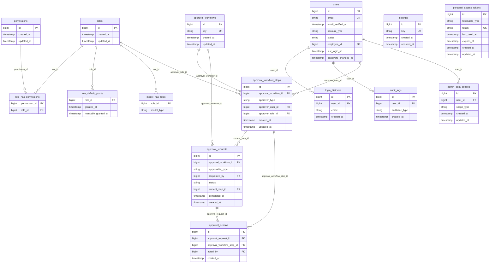

### 4.2 Organisation

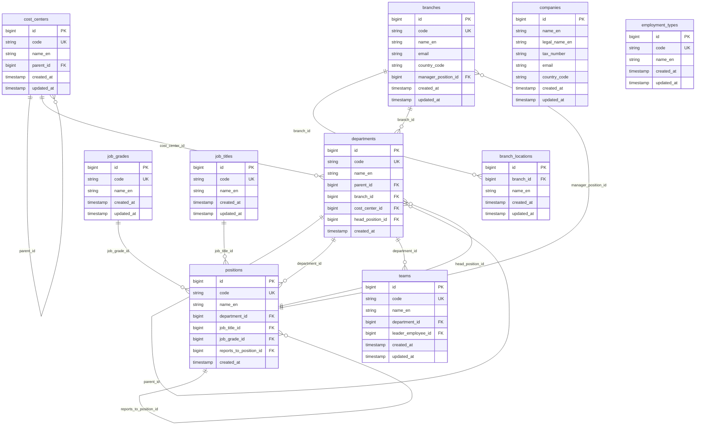

### 4.3 Employees

```mermaid
erDiagram
    employee_contracts ||--o{ employee_contracts : "renewal_of_id"
    employee_custom_fields ||--o{ employee_custom_field_values : "custom_field_id"
    employee_groups ||--o{ employee_group_members : "employee_group_id"
    employees ||--o{ employee_assignments : "employee_id"
    employees ||--o{ employee_assignments : "manager_id"
    employees ||--o{ employee_bank_accounts : "employee_id"
    employees ||--o{ employee_contracts : "employee_id"
    employees ||--o{ employee_custom_field_values : "employee_id"
    employees ||--o{ employee_documents : "employee_id"
    employees ||--o{ employee_emergency_contacts : "employee_id"
    employees ||--o{ employee_group_members : "employee_id"
    employees ||--o{ employee_salaries : "employee_id"
    employees ||--o{ employees : "manager_id"
    employees ||--o{ users : "employee_id"
    employees {
        bigint id PK
        string employee_number UK
        bigint candidate_id FK
        bigint job_application_id FK
        string name_en
        date date_of_birth
        string marital_status
        string national_id_hash UK
    }
    employee_assignments {
        bigint id PK
        bigint employee_id FK
        string change_type
        date effective_date
        bigint branch_id FK
        bigint department_id FK
        bigint team_id FK
        bigint position_id FK
    }
    employee_salaries {
        bigint id PK
        bigint employee_id FK
        string change_type
        date effective_date
        decimal14_2 basic_salary
        timestamp applied_at
        timestamp cancelled_at
        bigint created_by FK
    }
    employee_contracts {
        bigint id PK
        bigint employee_id FK
        string reference
        string contract_type
        date start_date
        date end_date
        bigint renewal_of_id FK
        bigint created_by FK
    }
    employee_documents {
        bigint id PK
        bigint employee_id FK
        date issue_date
        date expiry_date
        bigint uploaded_by FK
        timestamp created_at
        timestamp updated_at
        timestamp deleted_at
    }
    employee_bank_accounts {
        bigint id PK
        bigint employee_id FK
        text account_number
        string iban_hash
        string swift_code
        timestamp created_at
        timestamp updated_at
    }
    employee_emergency_contacts {
        bigint id PK
        bigint employee_id FK
        timestamp created_at
        timestamp updated_at
    }
    employee_groups {
        bigint id PK
        string code UK
        string name_en
        timestamp created_at
        timestamp updated_at
    }
    employee_group_members {
        bigint employee_group_id FK
        bigint employee_id FK
        timestamp created_at
    }
    employee_custom_fields {
        bigint id PK
        string code UK
        string name_en
        string type
        timestamp created_at
        timestamp updated_at
    }
    employee_custom_field_values {
        bigint id PK
        bigint employee_id FK
        bigint custom_field_id FK
        decimal18_4 value_number
        date value_date
        timestamp created_at
        timestamp updated_at
    }
    users {
        bigint id PK
        string email UK
        timestamp email_verified_at
        string account_type
        string status
        bigint employee_id FK
        timestamp last_login_at
        timestamp password_changed_at
    }
```

### 4.4 Recruitment & lifecycle

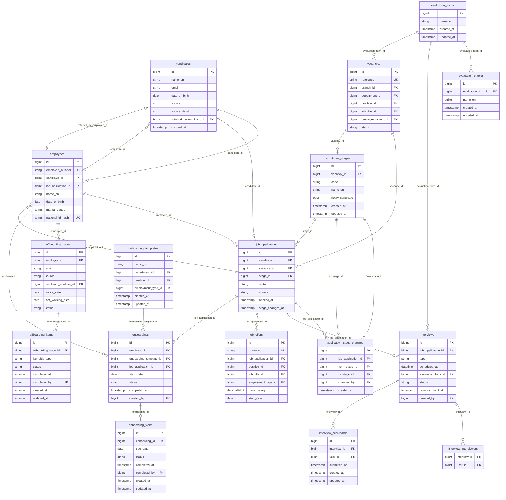

### 4.5 Attendance

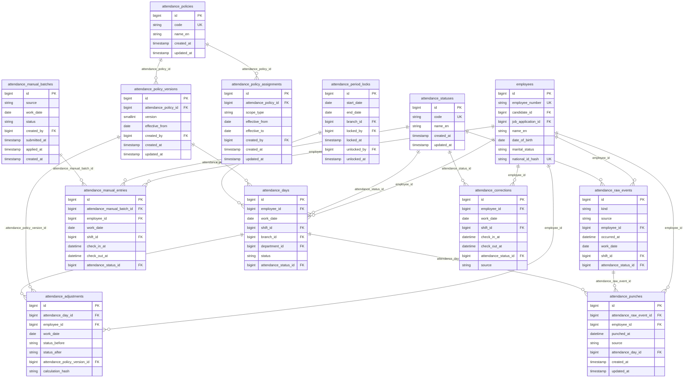

### 4.6 Attendance capture (devices, mobile, face)

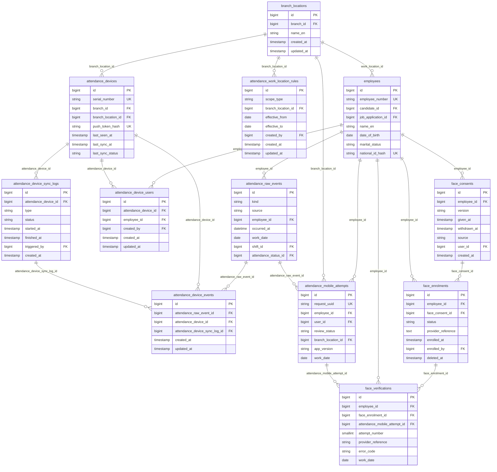

### 4.7 Shifts & schedules

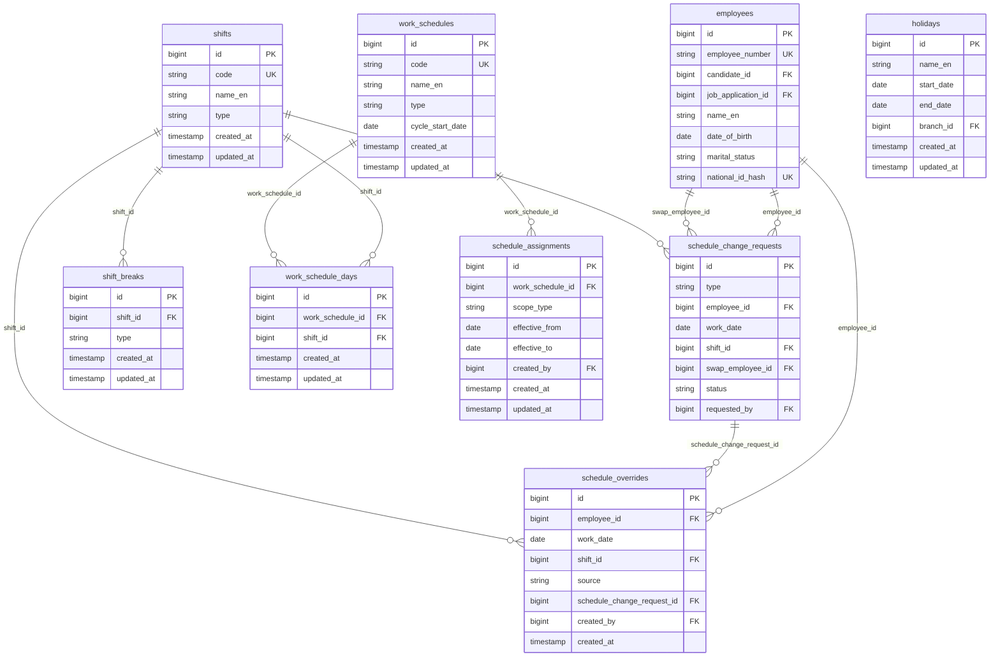

### 4.8 Leave

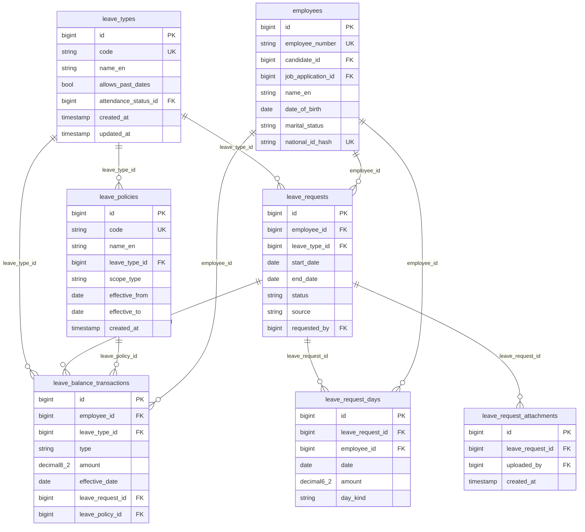

### 4.9 Payroll components & loans

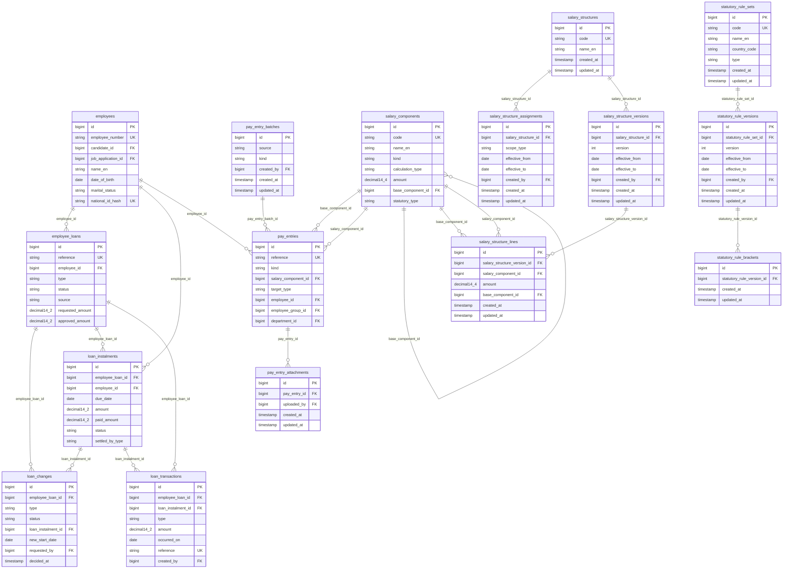

### 4.10 Payroll runs & payslips

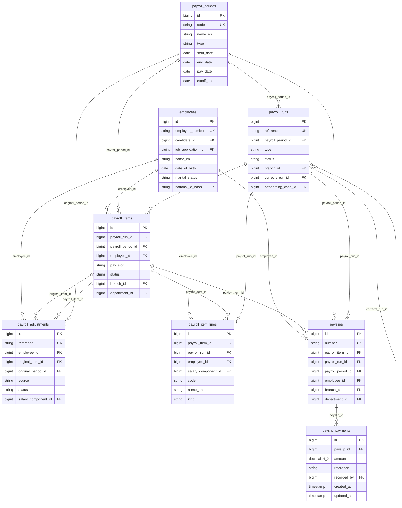

### 4.11 Performance & training

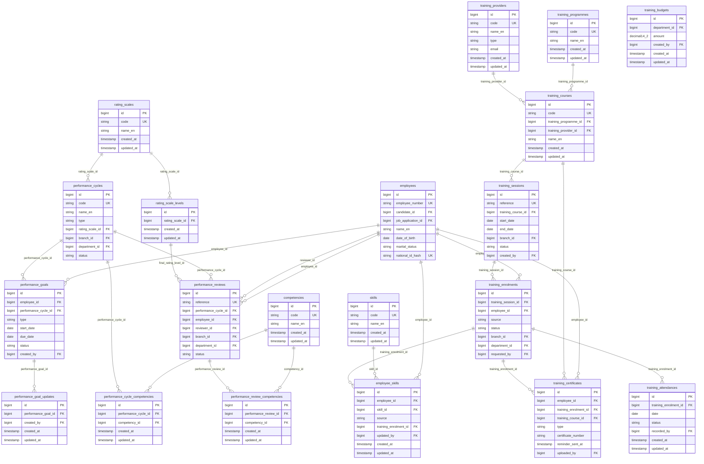

### 4.12 Assets & disciplinary

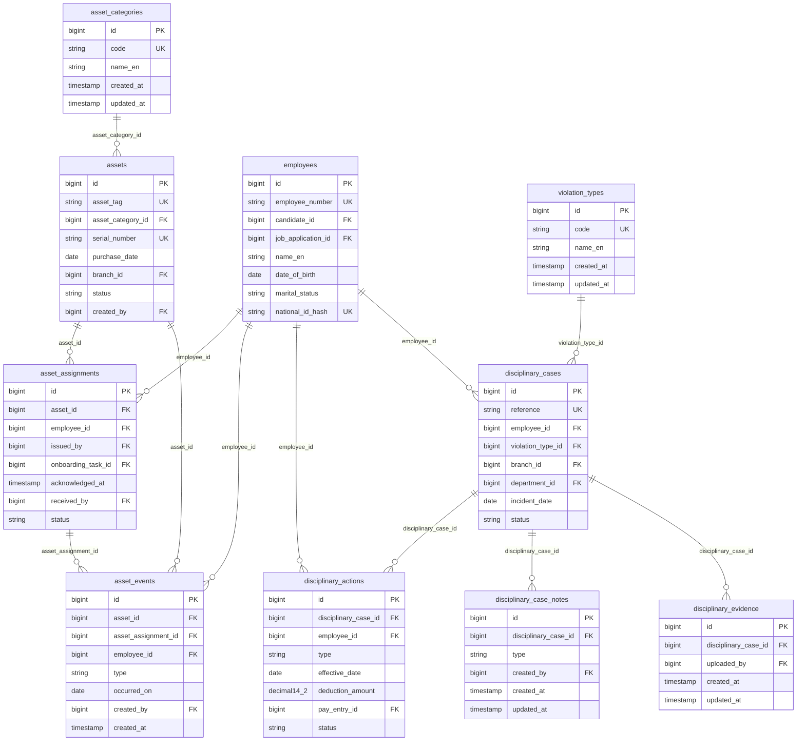

### 4.13 HR requests, announcements, notifications

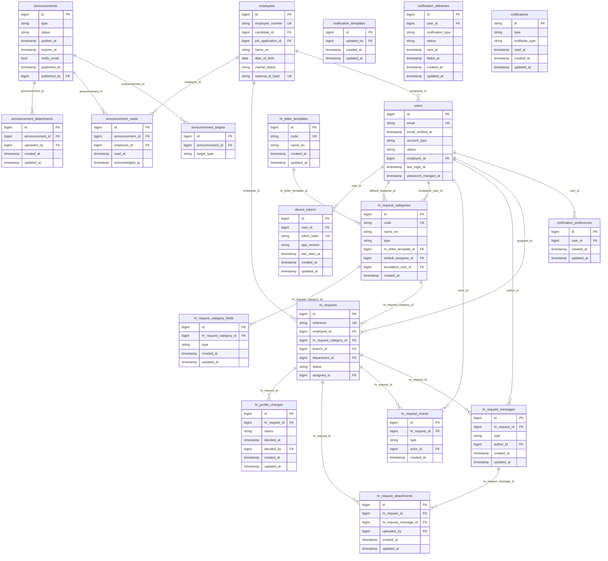

---

## 5. Polymorphic links and cross-module contracts

Some relations are polymorphic (`*_type` + `*_id`, using Laravel's morph map) and therefore do not appear as
foreign keys in the diagrams:

| Column | Points to |
|---|---|
| `approval_requests.approvable_*` | leave requests, attendance corrections / manual batches, schedule changes, job offers, pay entries, loans / loan changes, payroll runs, performance reviews, training enrolments, disciplinary actions, HR requests |
| `audit_logs.auditable_*` | any audited model |
| `attendance_raw_events.origin_*` | the manual batch / correction / device event / mobile attempt that created the event |
| `pay_entries.source_*` | e.g. the disciplinary action behind a deduction |
| `payroll_item_lines.sourceable_*` | pay entry, loan instalment, statutory rule version, leave transaction, payroll adjustment |
| `loan_instalments.settled_by_*` | the payroll item that recovered the instalment |
| `offboarding_items.itemable_*` | asset assignment (clearance), loan, final settlement |
| `notifications.notifiable_*` | users |

Services that read across modules (so that precedence and versioning stay in one place):
`ScheduleResolver` (schedules), `AttendanceEngine` (days), `LeavePayrollFeed` (unpaid / encashed leave for payroll),
`PayrollInputs` / `PayrollCalculator` (payroll), `AttendanceQuantities` (attendance quantities for payroll),
`PayrollCorrections` (post-finalisation differences). See `PAYROLL_ENGINE.md`.

---

## 6. Framework and infrastructure tables

`migrations`, `cache`, `cache_locks` (also used for scheduler `onOneServer` locks), `jobs`, `job_batches`,
`failed_jobs` (database queue), `sessions` (database sessions — used by *Account settings* to list signed-in
browsers), `password_reset_tokens` (web reset links), `personal_access_tokens` (Sanctum API tokens with
`expires_at`).

---

## 7. Maintenance notes

- Never edit history tables by hand (raw events, ledgers, finalised payroll); use the application's correction
  flows so that audit trails stay consistent.
- Back up the database **and** `storage/app/private` together, and keep the `APP_KEY`: encrypted columns and
  encrypted biometric files cannot be read without it.
- Indexes: every foreign key is indexed; Phase 11 added composite indexes for the dashboard, reports and the
  schedule resolver (`2026_11_22_100000_add_performance_indexes`).
- Regenerate the diagrams from `information_schema` after schema changes (the generator used for this document
  reads `KEY_COLUMN_USAGE` and `COLUMNS`).
